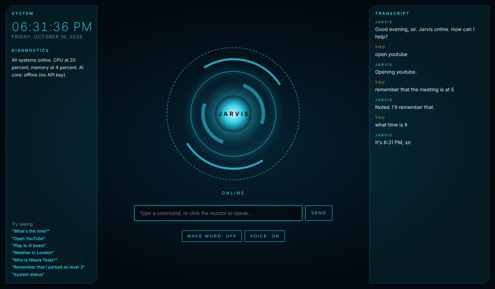

# J.A.R.V.I.S. — your personal AI assistant

*Just A Rather Very Intelligent System.* Talk to it, and it answers out loud,
opens websites and apps, plays music on YouTube, checks the weather, looks things
up on Wikipedia, remembers things for you, and holds real conversations using
Claude.



## Three ways to run it

| Mode | Command | Good for |
|---|---|---|
| **Web HUD** | `python -m jarvis --hud` | The Iron Man look. Click the arc reactor (or press Space) and speak. Voice runs in the browser (Chrome/Edge), so no audio packages are needed. |
| **Voice** | `python -m jarvis` | Hands-free in the terminal. Say *"Jarvis, open YouTube"*. |
| **Text** | `python -m jarvis --text` | Typing instead of talking. |

Extra flags: `--no-wake` (no need to say "Jarvis" first), `--mute` (print replies without speaking them).

Run these from the folder that **contains** `jarvis/` (the repository root).

## Setup

You need **Python 3.10+**.

```bash
# 1. (recommended) virtual environment
python -m venv .venv
# Windows:      .venv\Scripts\activate
# macOS/Linux:  source .venv/bin/activate

# 2. install packages
pip install -r jarvis/requirements.txt

# 3. give JARVIS its AI brain (get a key at https://console.anthropic.com)
# Windows (PowerShell):  $env:ANTHROPIC_API_KEY="sk-ant-..."
# macOS/Linux:           export ANTHROPIC_API_KEY="sk-ant-..."

# 4. start it
python -m jarvis --hud
```

Without an API key, every built-in command below still works; only free-form conversation is switched off.

**If `pyaudio` fails to install** (only needed for terminal voice mode):

- Windows: `pip install pipwin && pipwin install pyaudio`, or just use `--hud`.
- macOS: `brew install portaudio` then `pip install pyaudio`.
- Linux: `sudo apt install portaudio19-dev python3-pyaudio espeak` then `pip install pyaudio`.

## What you can say

| Say | JARVIS does |
|---|---|
| "What's the time?" / "What's the date?" | Tells you |
| "Open YouTube" / "Open github.com" | Opens the site in your browser |
| "Open Notepad" / "Launch Spotify" | Starts a desktop app |
| "Play Believer by Imagine Dragons" | Searches it on YouTube |
| "Search for best laptops 2026" | Google search |
| "Who is Nikola Tesla?" / "Tell me about black holes" | Reads a short Wikipedia summary |
| "Weather in London" / "What's the weather?" | Current weather (via wttr.in) |
| "System status" | CPU, memory and battery |
| "Remember that I parked on level 3" | Saves a note (kept in `~/.jarvis/memory.json`) |
| "What do you remember?" | Reads your notes back |
| "Tell me a joke" | Programmer humour |
| "Goodbye" | Shuts down (terminal modes) |
| *Anything else* | Claude answers in character, and can use all of the skills above itself, e.g. "I need to fix a bug, pull up the place where I keep my code". |

## How it works

```
 microphone ──► speech-to-text ──► brain.respond(text)
                                     │
                    skills.handle_local()  ── matches a built-in command? ──► run it (fast, offline, free)
                                     │ no
                                     ▼
                    Claude (with tools = the same skills) ──► may call open_website, get_weather, ...
                                     │
 speaker ◄── text-to-speech ◄────── reply
```

| File | Role |
|---|---|
| `__main__.py` | Startup, wake word, voice/text loops |
| `brain.py` | Routes to built-in commands or Claude; runs the tool-use loop; keeps conversation memory |
| `skills.py` | Everything JARVIS can do, plus the tool definitions Claude sees |
| `voice.py` | Microphone (SpeechRecognition) and voice (pyttsx3) |
| `hud.py`, `hud.html` | The web HUD (localhost only) |
| `memory.py` | Long-term notes |
| `config.py` | Settings |

## Customising

Set environment variables (or edit `config.py`):

| Variable | Default | Meaning |
|---|---|---|
| `JARVIS_NAME` | `Jarvis` | Name and wake word, e.g. `Friday` |
| `JARVIS_USER_TITLE` | `sir` | What it calls you, e.g. `boss`, `ma'am`, your name |
| `JARVIS_CITY` | *(auto)* | Default city for weather |
| `JARVIS_MODEL` | `claude-opus-5-5` | Claude model |
| `JARVIS_EFFORT` | `low` | `low` = quickest replies; `medium`/`high` = more thoughtful |
| `JARVIS_HUD_PORT` | `8765` | Web HUD port |
| `JARVIS_VOICE_RATE` | `185` | Speaking speed (terminal mode) |

**Add your own skill:** write a function in `skills.py` that returns a sentence, add a regex to `_COMMANDS` for instant matching, and (optionally) add it to `TOOLS` and `_TOOL_FUNCS` so Claude can use it too.

## Tests

```bash
python -m unittest discover -s jarvis/tests -t .
```

The tests mock the browser, network and Claude, so they run offline with no API key.
